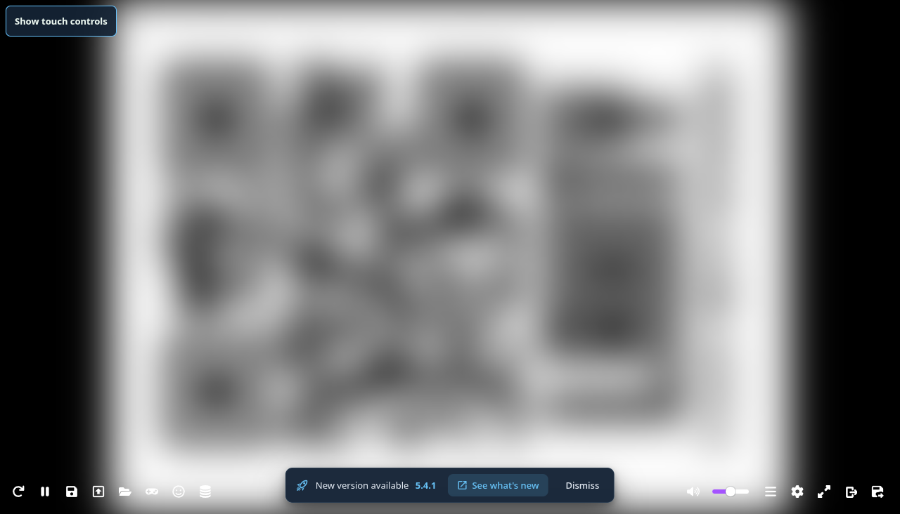

# Steam Deck setup

[Illustrated Steam Deck guide](https://rommayo.quentinmayo.com/steam-deck) · [Downloads](https://rommayo.quentinmayo.com/#downloads)

Rommayo is a Linux AppImage you add as a non-Steam game. It has no Steam store integration or Valve verification.

## Install in Desktop Mode

1. Open **STEAM → Power → Switch to Desktop**, then open **Konsole**.
2. Run the dedicated Deck command:

```sh
curl -fsSL https://rommayo.quentinmayo.com/steam-deck.sh | bash
```

[Read the installer](../scripts/install.sh) before running it. The site bootstrap pins and verifies the installer source; the installer verifies the packaged release’s SHA-256. It needs no sudo, system unlock, FUSE installation, Node.js or npm. Rommayo connects to your own RomM server; the public website has no visitor login.

The executable is `~/.local/share/rommayo/Rommayo.AppImage`, the launcher is `~/.local/bin/rommayo`, and an application menu entry is created. The launcher uses AppImage extraction and includes `--deck --ozone-platform=x11`.

## Add it to Gaming Mode

1. In Desktop Mode, open **Steam → Games → Add a Non-Steam Game to My Library**.
2. Search for **Rommayo**, check it and choose **Add Selected Programs**. If missing, browse to `/home/deck/.local/bin/rommayo`.
3. Open shortcut **Properties** and leave forced **Compatibility / Proton** disabled. No extra launch options are needed for the generated launcher.
4. Choose **Return to Gaming Mode** on the desktop, then **Library → Non-Steam → Rommayo → Play**.


For a manual AppImage download, make it executable and add the AppImage itself to Steam. Set its **Launch Options** to:

```sh
env -u LD_PRELOAD APPIMAGE_EXTRACT_AND_RUN=1 %command% --deck --ozone-platform=x11
```

This enables extraction without FUSE, selects XWayland and excludes the overlay library. Use this only for a shortcut targeting the AppImage directly; the generated installer launcher already handles it.

## Connect and configure controls

Enter the RomM URL/IP, username and password you already use. Acknowledge the server notice and HTTP notice if applicable. **Remember login** retains the cookie between app restarts; passwords are never saved. The desktop toolbar has **Log out**, which preserves local game saves. Press **Esc** to expose the toolbar if fullscreen hides it.

The Deck launcher excludes `LD_PRELOAD` to prevent Steam’s injected overlay library from stalling Electron startup. It also selects XWayland. Steam’s system menu remains available.

Use a Steam Input gamepad layout. Keep sticks, D-pad and face buttons assigned as gamepad inputs. For the connection form and file picker, configure **Right Trackpad → As Mouse**, with trackpad press or a trigger assigned to **Left Mouse Click**. **STEAM + X** opens the keyboard. Configure gameplay mapping in the RomM player’s **Control Settings**.

If the on-screen keyboard duplicates a connected keyboard’s input, close it with **B / STEAM + X** before typing. For a RomM server on plain HTTP, gamepad APIs can be restricted; use trusted HTTPS or map Steam Input to the player’s keyboard controls.

Save or export before leaving the player. Keep exported backups before clearing app data or moving devices. Close Rommayo before rerunning the installer to update; it preserves app profiles and keeps the previous AppImage as `Rommayo.AppImage.previous`.

## Test evidence

Physical Steam Deck testing on October 22, 2026 used a GLKVM and a docked 1920 × 1080 display. The checksum-verified installer, AppImage launch, live RomM login/library and C64 homebrew core boot were verified. Gaming Mode app launch was also verified after excluding Steam overlay injection. Gameplay and built-in controller results are tracked in [compatibility](compatibility.md). Universal core, controller and suspend/resume certification is not implied.

Published screenshots redact private connection details and blur game artwork where it appears. No games, BIOS files or credentials are included in the repository.

## Steam artwork, remembered sessions and exit controls

The Deck installer includes original icons, portrait/landscape covers, hero and logo art. For Steam to retain shortcut changes, fully exit Steam in Desktop Mode (**Steam → Exit**), then run `~/.local/bin/rommayo-steam-artwork`. Reopen Steam afterward. The helper adds the shortcut if missing, preserves existing app IDs and controller settings, and backs up changed shortcut/art files beside the originals with a `.mayo-backup-...` suffix. It refuses to edit shortcuts while Steam is running.

During Deck gameplay the original EmulatorJS toolbar stays visible and clickable. The separate bottom bar has navigation, Fullscreen and **Quit app**. **Game controls** offers labeled shortcuts to the existing player actions. Open it with touch, **F10**, or **L3 + R3** on a standard gamepad; use D-pad to move, A to select, B to close. Save/load/import/export still use the player’s own handlers. Unsupported engines show a message instead of pretending an action succeeded.

Save/export before leaving. **Quit app** asks before closing; alternatively press **STEAM → Exit game** and confirm. Quitting does not save automatically or log you out. If the player itself is in HTML fullscreen, its toolbar remains available; use Steam’s system menu to exit the app.

With **Remember login** checked, Rommayo now automatically reopens the last server at startup using its cookie and saved theme choice. Your password is never stored. An expired session shows RomM’s sign-in page. **Log out**, **Forget sessions**, switching servers, or an unchecked login stops automatic reopening. Android already restores remembered sessions.

## Touch controls and returning home

Use **Hide touch controls** at the top left to remove the on-screen D-pad and action buttons when using a handheld controller. **Show touch controls** brings them back. The choice is remembered between games, and the toggle remains inside HTML fullscreen. The original EmulatorJS toolbar stays available; on a wide player it remains visible along the bottom.

Save/export first, then choose **Exit** in EmulatorJS. **Cancel** keeps the game open. Confirmed Exit returns to the native Android library or the desktop RomM home without logging out. **Quit app** closes the companion after its own confirmation.



Linux 0.2.9 candidate checks on a real Deck verified remembered login, authorized C64 core boot, fullscreen containment, hide/show, Cancel, confirmed Exit and a remembered control preference after relaunch. These checks ran in Desktop Mode with `--deck` and X11. Current-update Gaming Mode and physical-button checks are tracked separately; this is not Steam Verified certification. Game imagery was blurred before capture.
